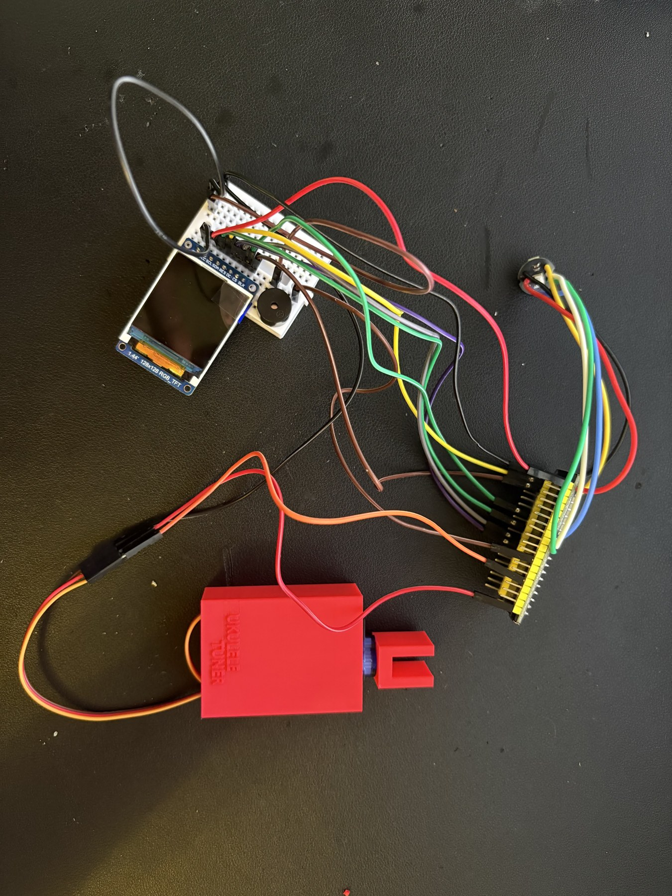
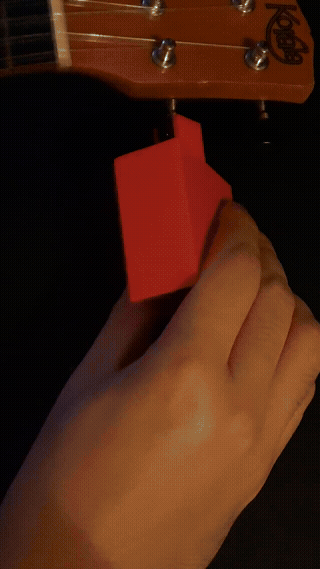
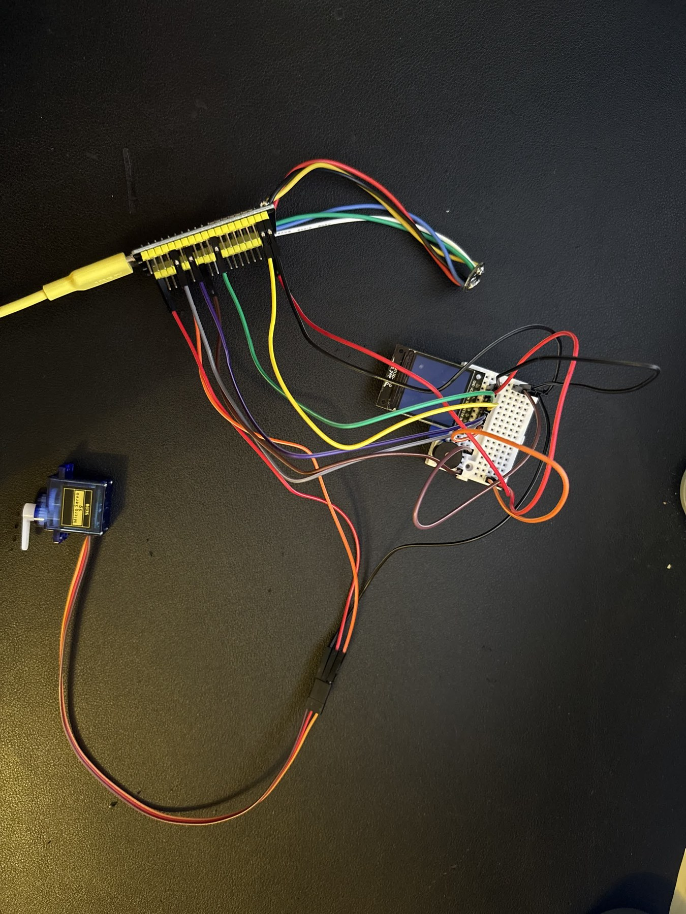
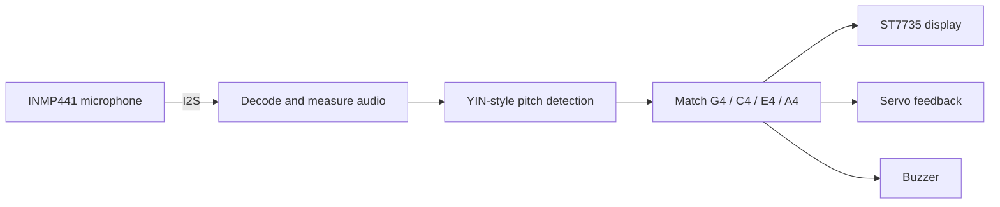

# ESP32 Ukulele Tuner

**A Rust ukulele tuner with microphone input, a color display, servo actuation, and audible feedback.**

The ESP32 samples an INMP441 I2S microphone, estimates pitch, compares it with standard high-G ukulele tuning, and reports whether the string is flat, sharp, or in tune.

<p align="center">
  
</p>

## See it in action

[](docs/media/ukulele-tuner-demo.mp4)

- [Watch the full tuning demonstration with audio (36 seconds)](docs/media/ukulele-tuner-demo.mp4)
- [Watch the early prototype clip (3 seconds)](docs/media/ukulele-tuner-short-demo.mp4)

The preview above is silent; open the full MP4 for the original audio. If GitHub offers a download instead of playback, download the video and open it locally.

<details>
<summary>Earlier breadboard prototype</summary>



</details>

## Signal path



## Features

- Standard tuning: G4 392.00 Hz, C4 261.63 Hz, E4 329.63 Hz, A4 440.00 Hz.
- Frequency and cents estimation with signal-level and confidence thresholds.
- In-tune tolerance of 8 cents, configured in `firmware/src/tuner.rs`.
- Separate Rust modules for audio, pitch detection, display, servo, and buzzer.
- Audio blanking after servo movement to reduce interference.

## Wiring

| Component | Signal | ESP32 GPIO |
| --- | --- | --- |
| ST7735 | Clock / MOSI | 18 / 23 |
| ST7735 | DC / reset | 17 / 16 |
| INMP441 | BCLK / WS / data | 26 / 25 / 33 |
| Servo | PWM | 13 |
| Buzzer | PWM | 14 |

Use a suitable supply for the servo and a common ground. Verify the display module power and chip-select wiring against your hardware.

## Build and flash

The firmware requires the Espressif Rust Xtensa toolchain (`esp`), `ldproxy`, and `espflash`. Its configuration selects `xtensa-esp32-espidf` and ESP-IDF v5.5.3.

```powershell
cd firmware
cargo build --release --locked
cargo run --release --locked
```

The Cargo runner invokes `espflash flash --monitor`. Connect the ESP32 by USB and select its serial port when prompted.

## Source map

| File in `firmware/src/` | Role |
| --- | --- |
| `main.rs` | Hardware setup and application loop |
| `audio.rs` | Microphone decoding and audio levels |
| `tuner.rs` | Pitch detection and target selection |
| `display.rs` | ST7735 driver and screens |
| `servo.rs` | Servo direction, stop, and self-test |
| `buzzer.rs` | Audible feedback |

## Calibration and validation

The servo performs a self-test at startup. Check direction and neutral pulse settings before attaching it to a tuning mechanism. Thresholds and tuning tolerance live in the source modules.

Documentation was checked against the supplied source. Compilation, pitch accuracy, and physical operation have not been revalidated for this repository snapshot. The source package's existing author metadata is preserved.
